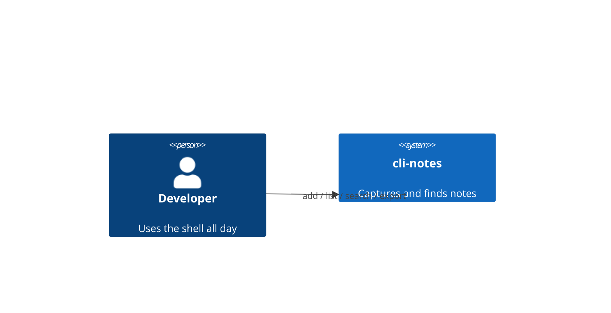
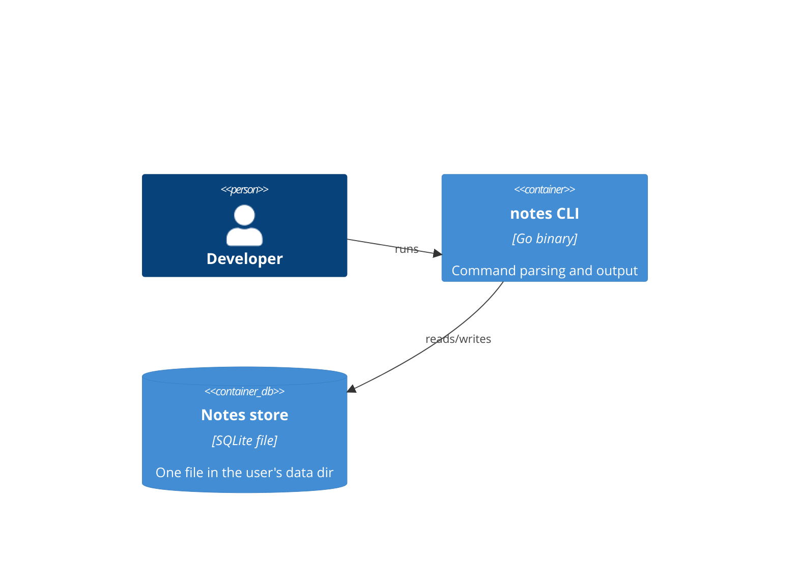

# Architecture — cli-notes

Decisions are recorded as ADRs in `adr/`. Sized for M1; M2 (sync, export) is
checked against it: SQLite rows export cleanly to Markdown and sync as a snapshot.

## Context

## Containers

## Decisions
- ADR-001 — storage: single JSON file (superseded by ADR-002).
- ADR-002 — storage: SQLite.

## Changelog
- v2: storage moved to SQLite (ADR-002).
- v1: initial architecture.
