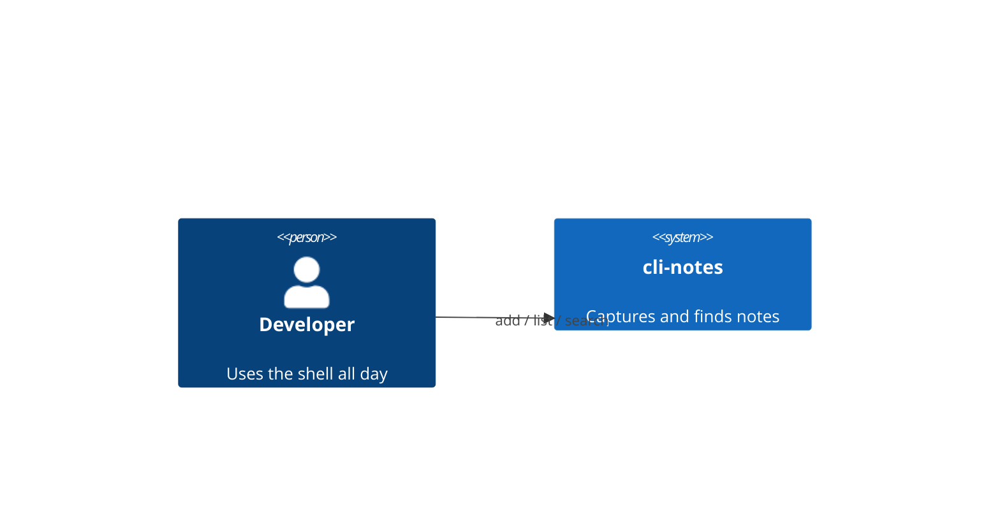
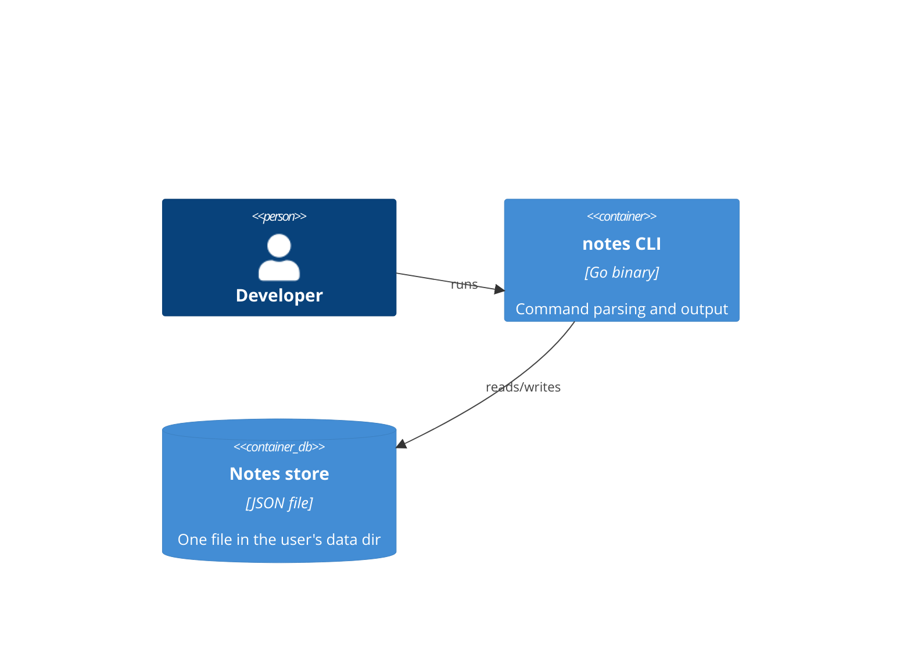

# Architecture — cli-notes

Decisions are recorded as ADRs in `adr/`. Sized for M1; M2 (sync) is checked
against it: a file-based store can be synced by a later adapter.

## Context

## Containers

## Decisions
- ADR-001 — storage: single JSON file.

## Changelog
- v1: initial architecture.
