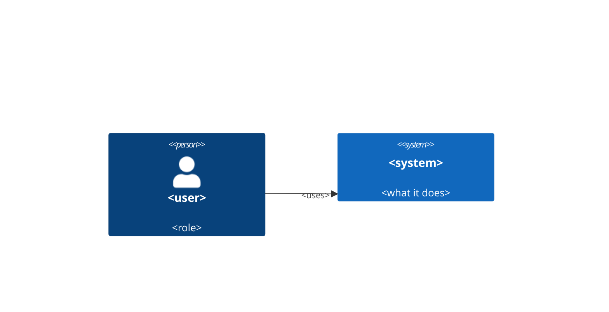
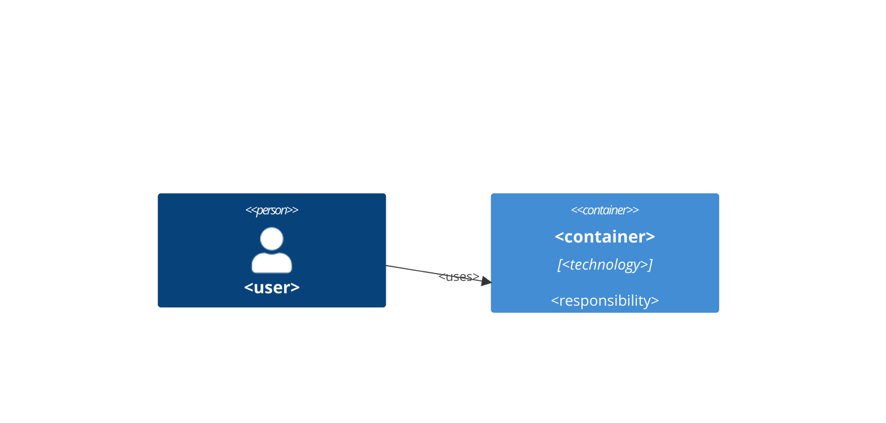

# Architecture — <project name>

Decisions are recorded as ADRs in `adr/`. Sized for M1; later milestones are
checked against it below.

## Context

## Containers

## Decisions
- ADR-001 — <topic>: <decision>.

## Later milestones check
<for each later milestone: does the M1 architecture still hold? what would break?>

## Changelog
- v1: initial architecture.
